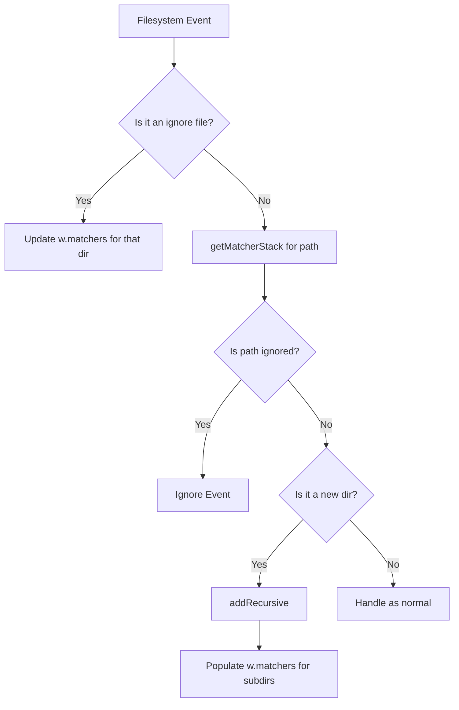

# Design: Nested Ignore Files in Watcher

## Objective
Enable the `watch` command to respect nested `.gitignore` and `.codesearchignore` files by maintaining and utilizing a stack of `Matcher`s during filesystem traversal and event handling.

## Proposed Changes

### 1. `internal/ignore` Package

To allow the `Watcher` to use the ignore logic, we need to export certain functions.

- **`internal/ignore/ignore.go`**:
    - Export `dirMatcher` as `DirMatcher`. This function is used to create a `Matcher` for a specific directory.
- **`internal/ignore/walker.go`**:
    - Export `isIgnored` as `IsIgnored`. This function checks if a path is ignored by a given stack of `Matcher`s.

### 2. `internal/watch` Package

The `Watcher` needs to keep track of matchers discovered during traversal to reconstruct the matcher stack for any given file path.

- **`Watcher` Struct**:
    - Add `matchers map[string]*ignore.Matcher` to store matchers for directories, keyed by their absolute path.
    - Ensure access to this map is synchronized using the existing `mu sync.Mutex`.

- **`NewWatcher`**:
    - Initialize the `matchers` map.

- **`getMatcherStack(path string) []*ignore.Matcher`**:
    - This new method will reconstruct the matcher stack for a given absolute `path`.
    - It starts with the root matcher (`w.matcher`).
    - It traverses upwards from `filepath.Dir(path)` to the repository root (`w.cfg.Root`).
    - For every ancestor directory that has a stored matcher in `w.matchers`, it adds that matcher to the stack.
    - The resulting stack is ordered from shallowest (root) to deepest (parent of `path`).

- **`addRecursive(root string)`**:
    - During the `filepath.WalkDir` traversal:
        1. For each entry, call `getMatcherStack(path)`.
        2. Use `ignore.IsIgnored(stack, rel, isDir)` to determine if the entry should be skipped.
        3. If the entry is a directory and is not ignored:
            - Call `ignore.DirMatcher(w.cfg.Root, path)` to check for new ignore files.
            - If a matcher is found, store it in `w.matchers[path]`.
            - Add the directory to the `fsnotify` watcher if it isn't already being watched.

- **`handleEvent(event fsnotify.Event)`**:
    - **Handling Ignore Files**: If the event path is a `.gitignore` or `.codesearchignore` file:
        - Update the `matchers` map for the directory containing the file.
        - If the file was created or modified, `w.matchers[dir] = ignore.DirMatcher(...)`.
        - If the file was removed or renamed, `delete(w.matchers, dir)`.
    - **Handling New Directories**: If `Create` event for a directory, call `addRecursive(path)`.
    - **Handling Files/General Events**:
        1. Call `getMatcherStack(path)`.
        2. Use `ignore.IsIgnored` to check if the event path is currently ignored.
        3. If it is ignored, ignore the event.
        4. Otherwise, proceed with regular event handling (e.g., if it's a directory, call `addRecursive`).

## Summary of Logic Flow

